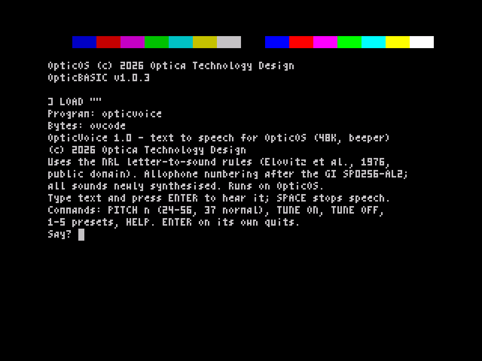
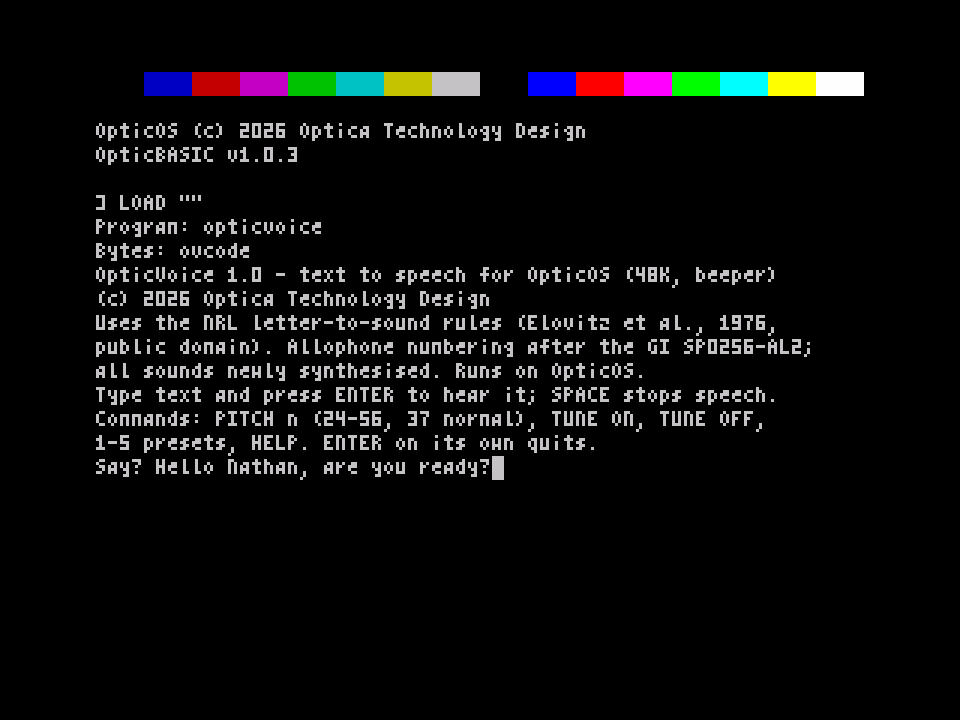
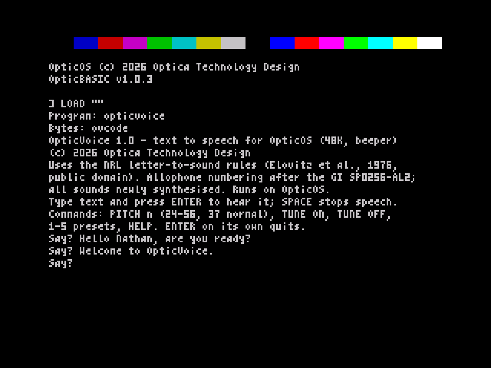
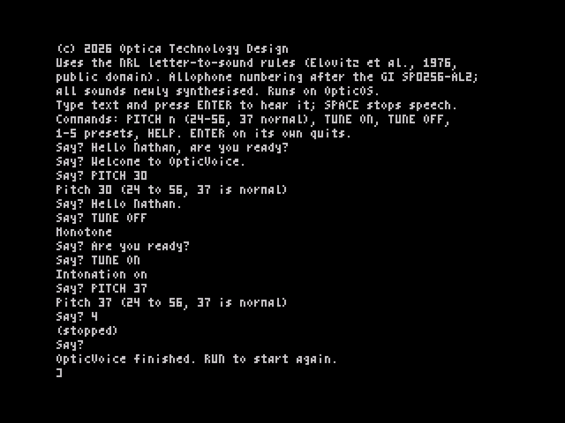
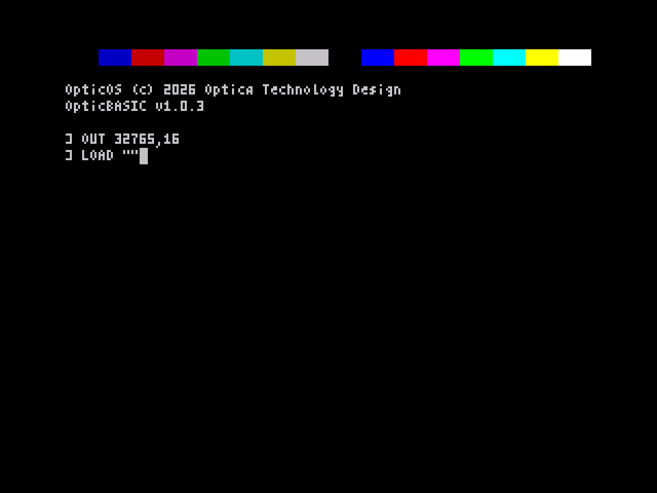
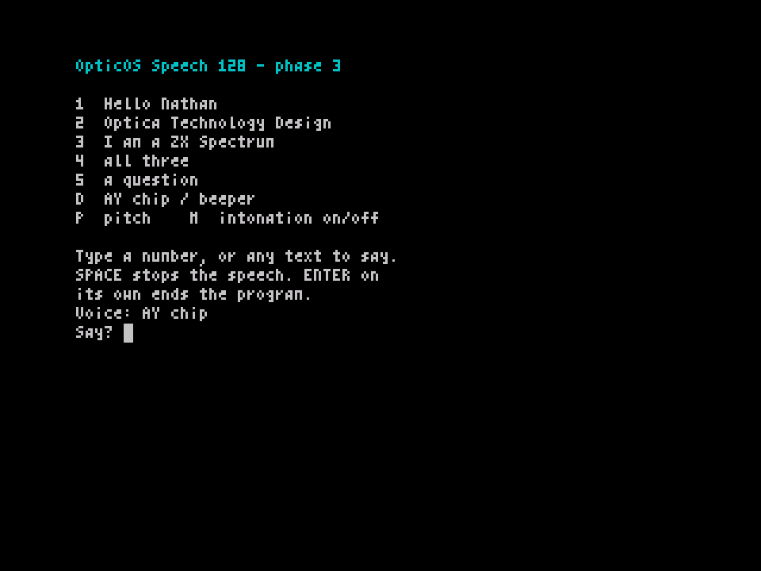
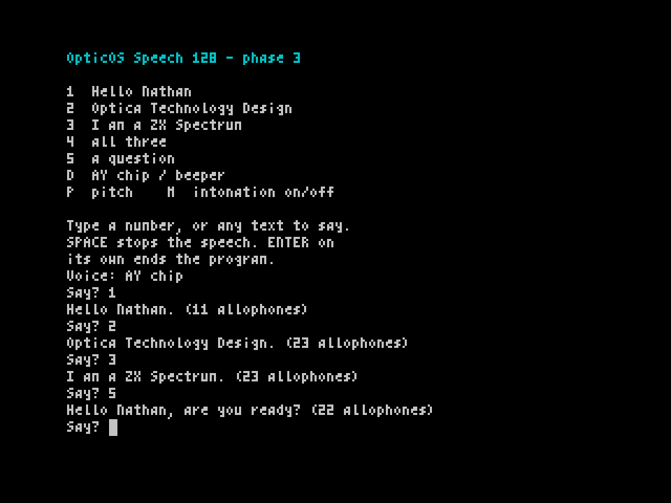
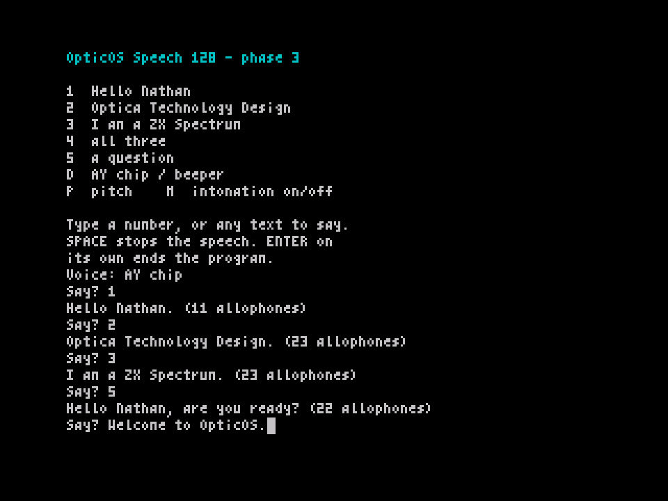
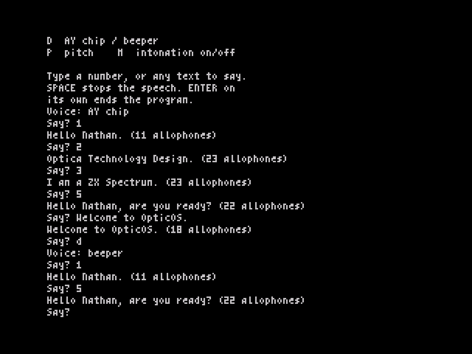
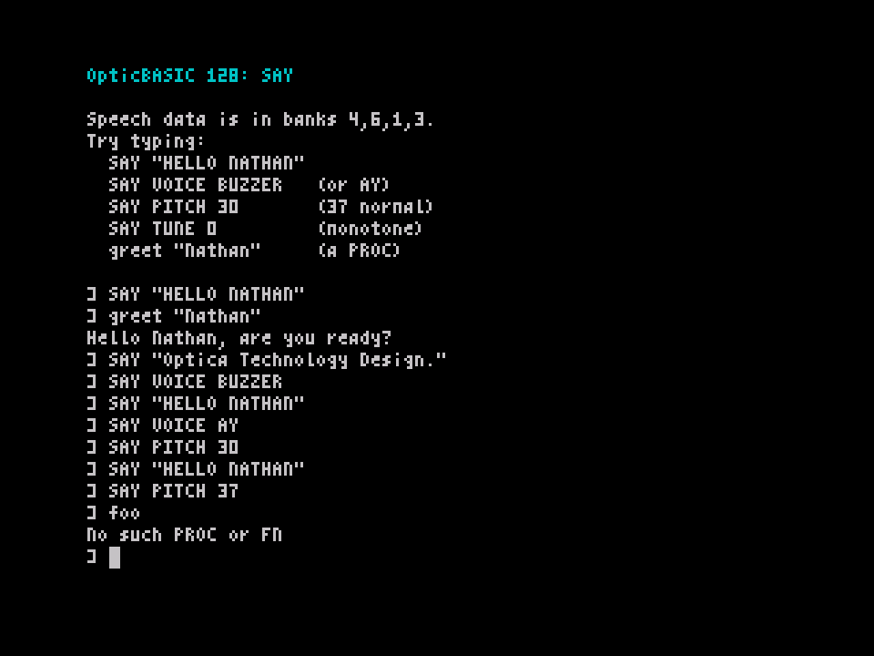

# OpticVoice (repository: ZX-Synth-Speak)

**OpticVoice** is a software text-to-speech synthesiser for the 48K Spectrum running
**OpticOS**, driven from OpticBASIC. Text is converted to SP0256-style
allophones by the NRL/Elovitz letter-to-sound rules (in Z80 machine code), refined
with context variants and a simple intonation pass, and played from
pre-synthesised 1-bit allophones held in RAM through the beeper (port 254, bit 4).
No extra hardware is needed.

**New in phase 3:** a **128K version** that plays through the **AY-3-8912** (4-bit
sample playback on all three channels, about 8 bits of level) with its sound data in
**paged 16K RAM banks**, a small resident player below $C000, and a documented bank
format and API for a future OpticBASIC 128K extension ([below](#128k-version-ay-3-8912-and-paged-banks)).
The beeper voice is still there on both machines (D switches on the 128K). Also: word
stress, and about 80 new exception words.

**Listen:** [`audio/opticvoice_sample.mp3`](audio/opticvoice_sample.mp3) (OpticVoice 48K in Fuse: "OpticVoice ready.", "Hello Nathan, are you ready?", "Welcome to OpticVoice."),
[`audio/compare_beeper_ay.mp3`](audio/compare_beeper_ay.mp3) (beeper, then AY: "Hello Nathan", "Hello Nathan, are you ready?", recorded from Fuse),
[`audio/presets_ay.mp3`](audio/presets_ay.mp3) (AY presets, from Fuse),
[`audio/presets_all.mp3`](audio/presets_all.mp3) (the three presets, beeper),
[`audio/question.mp3`](audio/question.mp3) ("Hello Nathan, are you ready?"),
[`audio/compare_phase1_phase2.mp3`](audio/compare_phase1_phase2.mp3) (each phrase as phase 1, then phase 2).

## OpticVoice 48K in Fuse with the OpticOS ROM

`LOAD ""` with `opticvoice.tzx`: the program auto-runs, prints what it is, says
"OpticVoice ready." and asks `Say?`. Screens from Fuse 1.6.0 (SDL, 48K) running the
OpticOS ROM, captured by `tools/fuse_test.py` (3x, 960 x 720).

| | |
|---|---|
|  |  |
| After `LOAD ""`: name, copyright, acknowledgements, options, `Say?` | Typing text to say |
|  |  |
| Spoken, and back at `Say?` | `PITCH`, `TUNE`, a preset stopped with SPACE, empty ENTER quits |

What it prints on RUN (plain lines, no screen clearing):

    OpticVoice 1.0 - text to speech for OpticOS (48K, beeper)
    (c) 2026 Optica Technology Design
    Uses the NRL letter-to-sound rules (Elovitz et al., 1976,
    public domain). Allophone numbering after the GI SP0256-AL2;
    all sounds newly synthesised. Runs on OpticOS.
    Type text and press ENTER to hear it; SPACE stops speech.
    Commands: PITCH n (24-56, 37 normal), TUNE ON, TUNE OFF,
    1-5 presets, HELP. ENTER on its own quits.
    Say?

### 128K, AY chip (Fuse `--machine 128`, OpticOS ROM in both ROM slots)

| | |
|---|---|
|  |  |
| OpticOS on Fuse's 128K machine | `OUT 32765,16` (see below), then `LOAD ""` |
|  |  |
| `speech128`: code and four banks loaded | Presets 1, 2, 3, 5 spoken by the AY chip |
|  |  |
| Typing your own text | D switches to the beeper, and back |

### OpticBASIC 128: a `SAY` keyword (prototype)

| | |
|---|---|
|  |  |
| `SAY "HELLO NATHAN"`, `SAY a$` in a PROC, `SAY VOICE`, `SAY PITCH` | `say128.tzx`: `SAY LOAD` fills banks 4, 6, 1, 3 |

On a 128K with OpticOS in ROM slot 0 and the new **extension ROM** in slot 1 (built by
`tools/gen.py` as `build/opticos128ext.rom`, from `src/ext128_main.asm` and the speech
code), `SAY` is a statement: no CLEAR, nothing resident in RAM. OpticOS needs a
14-byte hook, on its branch `opticos128-say`. Design, syntax, the hook and the
limitations: [`docs/opticbasic128-say.md`](docs/opticbasic128-say.md). Listen:
[`audio/say_demo.mp3`](audio/say_demo.mp3) (Fuse: SAY with the AY, a PROC, then the beeper).

    fuse --machine 128 --rom-128-0 opticos.rom --rom-128-1 build/opticos128ext.rom --tape say128.tzx
    LOAD ""                     (runs SAY LOAD, then SAY "Speech is ready.")
    SAY "HELLO NATHAN"

## Quick start

    LOAD ""            (opticvoice.tzx: BASIC "opticvoice" auto-runs, then CODE "ovcode")

At `Say?`, type any text and press ENTER to hear it. A line that is a command is obeyed
instead (any case): `PITCH n` (24–56, 37 normal, smaller is higher), `TUNE ON` /
`TUNE OFF` (intonation / monotone), `1`–`5` presets (1 "Hello Nathan", 2 "Optica
Technology Design", 3 "I am a ZX Spectrum", 4 all three, 5 "Hello Nathan, are you
ready?"), `HELP` (prints the lines again). SPACE stops the speech; ENTER on its own
quits to BASIC ("OpticVoice finished. RUN to start again."). RUN again does not reload
the code if it is still in memory (it checks the "SP" signature and version at 45073).

128K: `speech128.tzx`. Type `OUT 32765,16` then `LOAD ""` (the program `speech128`
auto-runs, loads `sp128code` and the banks; D switches AY chip / beeper).

## Calling it from OpticBASIC

    CLEAR 45055
    LOAD "ovcode" CODE
    DEF PROC say(s$)
      LOCAL a, i, n
      a = DPEEK(45071)
      FOR i = 1 TO LEN s$: POKE a + i - 1, ASC MID$(s$, i, 1): NEXT i
      POKE a + LEN s$, 0
      n = USR 45056
    ENDPROC

| Address | What |
|---|---|
| `n = USR 45056` | convert the text at TEXTPTR (0 or 13 ends it, up to 250 characters) and say it; n = number of allophones |
| `n = USR 45059` | say the allophone list at LISTPTR (`$FF` ends it) |
| `n = USR 45062` | convert only; the list goes to `DPEEK(45069)` |
| 45065 / 45067 | TEXTPTR / LISTPTR (DPOKE to use your own buffers) |
| 45069 / 45071 | address of the allophone buffer / text buffer (read only) |
| 45073 | "SP" signature |
| 45075 | STOPPED: 1 if SPACE stopped the last phrase |
| 45076 | PITCH: voiced period in bytes, 37 = 105.6 Hz (normal); smaller is higher; 24–56 is sensible |
| 45077 | INTON: 1 = intonation (default), 0 = monotone |
| 45078 | VARIANTS: 1 = context variants (default), 0 = the rules' allophones as they are |
| 45079 | version (3) |
| 45080 | DEVICE: 0 beeper, 1 AY (128K build only) |
| 45081 | BANKM (128K build only, below) |
| `USR 45082` | 1 if port $7FFD pages RAM (a 128K), else 0 |
| 45085 / 45087 | address of the beeper / AY allophone directory |

* Any case. Spaces give a short pause, `,` `;` `:` `-` a medium pause, `.` `!` `?` a
  long pause; digits are spoken ("1" → "one").
* Allophone codes are SP0256 numbers 0–63; **bits 6–7 are the pitch level** (0 mid,
  1 low, 2 high, 3 top). `USR 45062` returns codes with these bits set.
* SPACE (so also BREAK) is checked before each allophone. Interrupts are off while
  a phrase plays; the border colour is kept.

### Interface changes in phase 3

* Everything from phase 2 is unchanged; version is now 3. New bytes 45080–45088
  (DEVICE, BANKM, detect, directory addresses) are used only by the 128K build.
* CODE block: `CODE 45056,18231` (OpticVoice 1.0; phase 3: 18203, phase 2: 17186); the buffers moved up again
  (use `DPEEK(45071)` / `DPEEK(45069)`).

### Interface changes from phase 1

* The three entry points, TEXTPTR/LISTPTR and the info words at 45069/45071 are unchanged.
* The buffers moved (text buffer now 62242, allophone buffer 62762): read them with
  `DPEEK(45071)` / `DPEEK(45069)` as before rather than hard-coding them.
* New variables at 45075–45079. Code bytes 64–254 in an allophone list now mean
  "code + pitch level" (phase 1 skipped them); lists of plain 0–63 codes play as before.
* CODE block: `CODE 45056,17186` (phase 1: 18690). CLEAR 45055 as before.

## Memory map

| Address | Hex | What |
|---|---|---|
| **CLEAR 45055** | | RAMTOP; everything above is the speech system |
| 45056–45088 | B000 | jump table and variables (above) |
| 45089–46956 | B021 | player, converter, post-pass with stress (1,868 bytes) |
| 46957–47274 | B76D | rule index, letter classes, variant tables (318) |
| 47275–50351 | B8AB | NRL rules and ~118 exceptions with stress marks (3,077) |
| 50352–50479 | C4B0 | allophone pointer table (128) |
| 50480–63286 | C530 | allophone waveform data (12,807) |
| 63287–63806 | F737 | text buffer and word buffer (520) |
| 63807–64318 | F93F | allophone list buffer (512) |

Saved block `CODE 45056,18231`; 19,263 bytes in all with the buffers (phase 3:
19,235). 64319–65535 is untouched (UDGs etc.).

## Intelligibility

20 test phrases (108 words: the presets, digits, game phrases and Harvard sentences),
rendered from the 1-bit data **exactly as the Z80 plays it**, filtered like a
speaker (60 Hz – 5 kHz), and transcribed by two automatic recognisers.
Score = reference words recognised, in order (`tools/evaluate.py`, results in `eval/`).

| Words recognised | vosk small-en | Whisper base.en |
|---|---|---|
| Phase 1, 1-bit beeper output | 3/108 (2.8%) | 23/108 (21.3%) |
| **Phase 2, 1-bit beeper output** | **31/108 (28.7%)** | **62/108 (57.4%)** |
| Phase 1, float synthesis (before 1-bit) | 8/108 (7.4%) | 19/108 (17.6%) |
| Phase 2, float synthesis (before 1-bit) | 22/108 (20.4%) | 54/108 (50.0%) |
| Phase 3, 1-bit beeper output (stress, exceptions) | 32/108 (29.6%) | 64/108 (59.3%) |
| **Phase 3, AY-3-8912 output (128K)** | **39/108 (36.1%)** | **67/108 (62.0%)** |

A second, **held-out set** (12 phrases, 49 words, never used for tuning: everyday and
computer sentences):

| Words recognised, held-out | vosk small-en | Whisper base.en |
|---|---|---|
| Phase 2, beeper | 11/49 (22.4%) | 36/49 (73.5%) |
| Phase 3, beeper | 12/49 (24.5%) | 37/49 (75.5%) |
| **Phase 3, AY** | **16/49 (32.7%)** | **37/49 (75.5%)** |

**Fuse's own sound, 128K machine** (`audio/fuse128_*.wav`, `eval/phase3_fuse128.json`), Whisper:

| Phrase | AY | Beeper |
|---|---|---|
| Hello Nathan. | "Hello Nathan" | "Hello Nathan" |
| Hello Nathan, are you ready? | "Hello, Nathan, are you ready?" | "Hello Nathan, are you ready?" |
| Welcome to OpticOS. | "Welcome to Octatops" | |
| I am a ZX Spectrum. | "I am a very very strong" | |
| Optica Technology Design. | (not recognised) | |

The AY gains most with vosk (+6.5 points on the main set, +8 on the held-out set): the AY's ~8-bit level sum has far
less quantising noise than 1 bit, so fricatives and weak consonants survive. Whisper,
which already copes with the beeper's noise, gains less. A stronger AY pre-emphasis
(0.9) scored 41.7% vosk but 53.7% Whisper on the main set and the same total over both
sets and recognisers, so the default stays at 0.7.

Whisper on the recordings: phase 1 "Hello no fun", phase 2 "Hello Nathan"; Fuse's
own sound output (`audio/fuse_question.wav`): "Hello Nathan, are you ready?" word for
word. Phrases that come through: "Hello Nathan", "This is a test", "Please press any
key", "Game over", "We like to play games on the computer", "It is easy to tell...".
Hard ones: "Optica", "ZX", "good morning", R/L-heavy and unusual words. Run-to-run
spread of these scores is about ±3 points; a recogniser is a proxy, not a listening test.

What made the difference, measured one change at a time on the same test:

1. **Pre-emphasis before the 1-bit coder** (biggest single gain: Whisper 25% → 46%).
   1-bit noise is flat across the band while a vowel's spectrum falls steeply, so F2/F3
   (which carry vowel identity) were buried. Lifting the highs first (y = x − 0.95·x₋₁,
   then a tanh soft clip) keeps them above the noise: the classic result that
   differentiated, clipped speech stays intelligible.
2. **Optimised 1-bit periods** instead of plain delta-sigma: each stored 296-bit pitch
   period is searched (single-bit flips and edge moves) to minimise the error after a
   speaker-band weighting. +1–2 dB in band, and Whisper 7% → 18% against plain DSM at
   the same settings. (A phase-free variant and multi-level PWM were considered; PWM is
   a special case of a 1-bit pattern at the same bit rate, so the optimised patterns
   dominate it, and the player's timing loop stays unchanged.)
3. **A new synthesiser**: five-formant cascade, glottal pulses aligned to period starts
   (so the player can change pitch), consonant transitions from place-of-articulation loci,
   proper relative levels, sibilants inside the speaker band.
4. **Blended joins**: vowel edges glide in from and out towards a neutral position over
   ~30 ms to meet the consonant transitions (vosk 13% → 29%).
5. **Context variants** (below) and a slightly faster rate (0.85).

## 128K version: AY-3-8912 and paged banks

**Method.** The AY's tone and noise generators are switched off (mixer, register 7 =
$3F), so each channel's output is just its 4-bit volume (registers 8, 9, 10), and the
three are summed in the analogue output. With a 256-entry table of (A, B, C) volume
triples sorted by their summed level (from the AY's logarithmic DAC curve), one byte per
sample gives ~256 distinct levels. The player writes the three volumes for every sample,
**259 T-states per sample (13.5 kHz at 3.5 MHz; 128 samples = exactly one 296-bit
beeper period)**, so the pitch, intonation and timing logic is shared with the beeper.
The same formant synthesis is resampled to 128 samples per period, pre-emphasised
(0.7), soft-clipped and quantised to the table with error feedback. This was clearer
(table above) than square-wave tone formants (only 3 coarse tones, no real formant
shape) and needs no hardware beyond the 128K's AY.

### Memory and bank layout (128K build)

| Where | What |
|---|---|
| **CLEAR 38911** | RAMTOP; 38912–49151 ($9800–$BFFF, bank 2, uncontended) is resident |
| 38912–38944 ($9800) | jump table and variables (same layout as the 48K version, base 38912) |
| 38945–41260 ($9821) | beeper player, AY player, paging, converter, post-pass (2,316 bytes) |
| 41261–44627 ($A12D) | rule index, classes, variants, NRL rules + exceptions (3,367) |
| 44628–44819 ($AE54) | `dirb`: beeper directory, 64 × (bank, address) (192) |
| 44820–45011 ($AF14) | `dira`: AY directory, 64 × (bank, address) (192) |
| 45012–46043 ($AFD4) | text, word and allophone buffers (1,032) |
| 46044–48383 ($B3DC) | free (2,340; saved as zeros) |
| 48384–49151 ($BD00) | `aytab`: AY volumes, 3 pages of 256 (A, B, C) (768) |
| bank 4 at $C000 | beeper allophones, all 64 (12,943 bytes) |
| bank 6 at $C000 | AY allophones 0–28 (16,171) |
| bank 1 at $C000 | AY allophones 29–51 (16,287) |
| bank 3 at $C000 | AY allophones 52–63 (11,242) |
| banks 0, 7 | not used (bank 0 is normal $C000 RAM: UDGs etc.); 5 and 2 as usual |

The resident block is saved as one `CODE 38912,10240`; each bank as `CODE 49152,n`
loaded with that bank paged in (`OUT 32765,16+bank` then `LOAD "" CODE`).

**Bank image format** (each bank describes itself, so a loader or extension can find
what it holds):

| Offset | Size | What |
|---|---|---|
| 0 | 4 | "SPKD" |
| 4 | 1 | format version (3) |
| 5 | 1 | device: 0 beeper, 1 AY |
| 6 | 1 | bank number it was built for |
| 7 | 1 | number of allophones in this bank |
| 8 | 128 | 64 × address (`dw`, $C000-based) of each allophone, 0 = not in this bank |
| 136 | – | allophone data |

Allophone data, both devices: frames of header `0` = end, `$80+n` = n silent periods,
otherwise bits 0–5 = repeat count and bit 6 = voiced, then one period: 37 bytes
(296 bits) for the beeper, 128 bytes (sample indexes into `aytab`) for the AY.

**Directories** (`dirb`, `dira`, addresses at base+29 / base+31): 64 × 3 bytes,
`db bank` / `dw address`. To move data to other banks, load the images there and
rewrite the bank bytes; nothing else changes.

### Paging

Port $7FFD is write-only, so the speech code keeps its own copy, **BANKM** (base+25,
38937, default `$10`: bank 0 at $C000, ROM slot 1, screen 5, not locked). For each
allophone the player (interrupts off) writes `(BANKM AND $F8) OR bank` to $7FFD,
plays from $C000, and writes BANKM back when the phrase ends or SPACE stops it. So:
**whatever pages memory must keep base+25 equal to the last value written to $7FFD.**
`USR 38938` (detect) checks that $7FFD really pages RAM (1 on a 128K, 0 on a 48K) and
leaves memory as it was.

### API (128K build, base = 38912)

| Address | What |
|---|---|
| `USR 38912` / `38915` / `38918` | say text / say allophone list / convert only (as 48K) |
| 38923 / 38925 / 38927 | LISTPTR / allophone buffer / text buffer (as 48K +11/+13/+15) |
| 38929 | "SP"; 38935 = version 3 |
| 38931–38934 | STOPPED, PITCH, INTON, VARIANTS (as 48K) |
| 38936 | DEVICE: 0 beeper (bank 4), 1 AY (banks 6, 1, 3) |
| 38937 | BANKM (above) |
| `USR 38938` | detect 128K paging |
| 38941 / 38943 | address of `dirb` / `dira` |

### Fuse's 128K machine and the 16K OpticOS ROM

The 128K has two ROM slots; OpticOS is a single 16K, 48K-style ROM, so the **same
OpticOS image goes in both**: `fuse --machine 128 --rom-128-0 opticos.rom --rom-128-1
opticos.rom`. OpticOS never touches $7FFD, so the paging state at reset (bank 0, ROM
slot 0) stays until a program changes it. No Sinclair ROM (48K or 128K) is used. Fuse's
tape traps only act when ROM slot 1 is paged, so type `OUT 32765,16` before `LOAD ""`
for a fast load (it also works without, at normal tape speed); the demo pages with
bit 4 set throughout. The 128K runs at 3.5469 MHz, so pitch is ~1.3% higher than on
the 48K. Banks 1 and 3 are contended on the 128K/+2 (a few T-states of jitter on some
samples while interrupts are off; not audible in Fuse). On the +2A/+3, banks 4–7 are
the contended ones instead; the timing still holds within a few percent.

### What a 128K OpticBASIC extension would need

1. **Reserve the banks** (4, 6, 1, 3, or others with the directories rewritten) and
   keep RAMTOP at 38911, or rebuild the resident block elsewhere below $C000
   (`gen.ORG128`; `aytab` must sit on a 256-byte boundary).
2. **Keep BANKM in sync**: store every value it writes to $7FFD in base+25 (or
   restore its own paging after a call). The player only changes bits 0–2 and restores.
3. A `SAY s$` keyword: copy the string to DPEEK(base+15), add a 0, call base+0; set
   base+24 for the device. Interrupts are off while speaking.
4. A loader that pages each bank and loads its image; the "SPKD" header gives device,
   bank and contents, so data can be checked, moved or loaded only when needed (for
   example the beeper bank alone).
5. Optionally a `SPEAK` setting for PITCH / INTON / VARIANTS (base+20…22).

## How it works

**Text → allophones (Z80, `convert`).** Upper-cased, normalised text runs through the
1976 NRL rules (context classes `# : ^ . + % & @`, greedy, as the original) plus an
exceptions dictionary (HELLO, NATHAN, OPTICA, ZX, SPECTRUM, DESIGN, TECHNOLOGY…).
Then a post-pass (`post`):

* **Context variants** (table-driven, 64 + 100 bytes): K → KK1 before front vowels,
  KK3 before back vowels and liquids, KK2 elsewhere; likewise GG1/GG3/GG2; TT2/DD2/BB2
  (released, with transitions) before vowels and liquids, TT1/DD1/BB1 elsewhere; HH1
  before front vowels, HH2 otherwise; NN1/NN2, DH1/DH2; RR2 after a consonant; EL for a
  syllabic L. The variants are synthesised with matching formant transitions, so they
  are real acoustic cues, not just names.
* **Intonation**: the last word before `.`, `!` or the end gets pitch level 1 (a fall),
  before `?` level 2 (a rise). Levels change the voiced period: the player plays 33,
  37 or 41 bytes of each voiced period (118, 106, 95 Hz), padding with a 15.6 kHz
  pattern when lengthening; the glottal pulse sits at the start of each period, so
  cutting the tail is clean.

* **Word stress** (new): exceptions mark the stressed vowel (`HH EH L OW1`). In words of
  two or more vowels the stressed vowel (or the first) is raised: level 2 mid-sentence,
  3 in a question; a statement's last word drops to level 1 with its stressed vowel at
  mid, so it falls.
* **Exceptions** (new, ~80): common irregulars (WHAT, WHERE, THROUGH, PEOPLE, WOMEN,
  COLOUR, ENOUGH, LISTEN, ISLAND…), R/L-heavy words (REALLY, EARLY, WORLD…, LITTLE,
  GIRL, ROLL, WORRY…), OPTICA, ZX ("zed ex"), OK, ZERO, MACHINE, PROGRAM, MEMORY.

The Z80 converter is checked bit-for-bit against the Python reference
(`tools/test_convert.py`: 2,377 conversions, including all INTON/VARIANTS settings,
0 differences, for both the 48K and the 128K build).

**Allophones (offline, `tools/synth.py`).** Source–filter formant synthesis at 31,250 Hz
(112 T-states per bit), pre-emphasis and soft clip, optimised 1-bit coding per pitch
period. Steady vowels store one period per 3, glides one per 2, noise one per 1–2;
silence costs nothing. Deterministic (noise is seeded per allophone).

Only the SP0256-AL2 allophone *names and numbering* are used, as a public reference.
No SP0256 data or recordings are used.

**Player (Z80, `play`).** For each allophone: check SPACE, pick the period length from
PITCH and the code's level, then walk the frames: header `0` = end, `$80+n` = n silent
periods, otherwise bits 0–5 = repeats and bit 6 = voiced, followed by 37 bytes. Each bit
is an exactly padded 112 T sequence (`rl e / sbc a,a / and 16 / or border / out ($FE),a`),
generated by `tools/gen.py`; data and code are above 32768, so there is no contention.
If SPACE stops it, it waits for the key to be let go and clears FLAGS bit 5, so BASIC
does not see the key.

## Building and testing

Needs Python 3 with numpy and scipy, pasmo, and an OpticOS checkout (for
`build/opticos.rom`, the `tools/rig` Z80 harness and the Fuse helpers): set `OPTICOS=`
to its path (default `/workspace/opticos-repo`). No Sinclair ROM is used anywhere.
For the scores: `pip install vosk openai-whisper` and the vosk-model-small-en-us-0.15
model in `ref/vosk/`.

    python3 tools/gen.py           # synthesise + code the allophones, pack rules, assemble both builds and the bank images
    python3 build.py               # type the demos into the rig, SAVE opticvoice.tap/.tzx, speech128.tap/.tzx and say128.tap/.tzx with the OpticOS ROM
    python3 tools/test_convert.py WORDS…   # Z80 converter == Python reference
    python3 tools/test_play.py "text" …    # USR 45056 in the rig; speaker edges vs the reference; SPACE stop; audio/*.wav
    python3 tools/fuse_test.py     # real Fuse 48K: OpticVoice start-up, Say?, PITCH/TUNE, SPACE, quit; shots/ov_*.png, audio/ov_*.wav
    BUILD=128 python3 tools/test_play.py "text" …   # 128K build: beeper from bank 4, AY path with paging emulated
    python3 tools/fuse_say_test.py # real Fuse 128K, OpticOS 128 (branch ROM + extension ROM): SAY; shots/say_*.png, audio/say_*.wav
    python3 tools/fuse128_test.py  # real Fuse 128K: speech128.tzx, AY and beeper; shots/fuse128_*.png, audio/fuse128_*.wav
    python3 tools/evaluate.py --asr vosk,whisper [--tools DIR] [--mode bits|float|ay] [--set main|held]

Results: converter 0 differences; player edges match the reference for every test
phrase (99.4% of edges within 0.6 bit, worst 10.6 bits at allophone boundaries; total
time +0.6% from the player's housekeeping); SPACE stops and returns cleanly; in Fuse
the tape loads and everything in the screens above works. 128K build: the same edge
match for the beeper from bank 4; the AY player (the rig has no AY, so paging is
emulated at the `al_pg` label and only timing is checked) plays the model's sample
count, +2–3% overall from the fade in/out and per-frame housekeeping. In Fuse's 128K
machine the tape loads, both voices speak and D switches between them.

## Audio (`audio/`)

* `compare_beeper_ay.mp3`: Fuse 128K, beeper then AY, two phrases
* `presets_ay.mp3`: Fuse 128K, AY: presets 1, 2, 3, the question, "Welcome to OpticOS"
* Fuse 128K captures: `fuse128_ay_1/2/3/5/welcome.wav`, `fuse128_bp_1/5.wav`
* `presets_all.mp3`, `question.mp3`, `hello_nathan.mp3` / `.m4a` (beeper)
* `compare_phase1_phase2.mp3`: four phrases, each phase 1 then phase 2
* rig recordings (the Z80 player's output in the test rig): `hello_nathan.wav`,
  `optica_technology_design.wav`, `i_am_a_zx_spectrum.wav`, `welcome_to_opticos.wav`,
  `one_two_three_four_five.wav`, `hello_nathan_are_you_ready.wav`
* Fuse's own sound output: `fuse_hello_nathan.wav`, `fuse_question.wav`,
  `fuse_high_pitch.wav` (PITCH 29), `fuse_monotone.wav`
* `phase1/`: the phase 1 recordings, for comparison

## Limitations

* Still a robotic, buzzy 1-bit voice: about half the words of unfamiliar sentences are
  recognised by Whisper, under a third by vosk. Short, common phrases fare best.
  No formal human listening test yet.
* Allophones are context-free apart from the variants and the blended vowel edges:
  with only 64 codes there are no true diphones or vowel-specific consonant data, so
  some joins are still abrupt. (Diphones are the obvious use for spare 128K banks.)
* Stress is pitch only (no lengthening), and only from exception words; rule-derived
  words get the accent on their first vowel.
* AY: needs the 128K's AY with mono mixing (on an ACB stereo add-on, each channel
  carries only part of the signal). AY timing is exact only in uncontended banks.
  "Optica", "ZX" and other unusual words are still weak on both devices.
* NRL rules mispronounce many irregular words; add exceptions in `tools/front.py`.
* Interrupts are off while a phrase plays (FRAMES does not advance); SPACE is checked
  between allophones, so stopping takes up to ~0.25 s.
* Pitch changes slightly alter the duration of voiced sounds.

## Possible next steps

Diphone frames for the commonest pairs in the spare banks (0, 7) on the 128K, vowel
lengthening for stress, a human listening test, and the OpticBASIC 128K extension's SAY.

## Licences and sources

See `LICENSE`: code MIT, documentation and audio CC BY 4.0.

* NRL rules: Elovitz, Johnson, McHugh & Shore, *Automatic Translation of English Text
  to Phonetics by Means of Letter-to-Sound Rules*, NRL Report 7948 (1976), public
  domain; JSON form from greg-kennedy/p5-NRL-TextToPhoneme (Unlicense), in `data/nrl/`.
* Formant targets after Peterson & Barney (1952) and Klatt (1980) published tables.
  Harvard sentences (IEEE 1969) in the test set.
* Synthesiser, coder, player, converter and data: original work for OpticOS.
