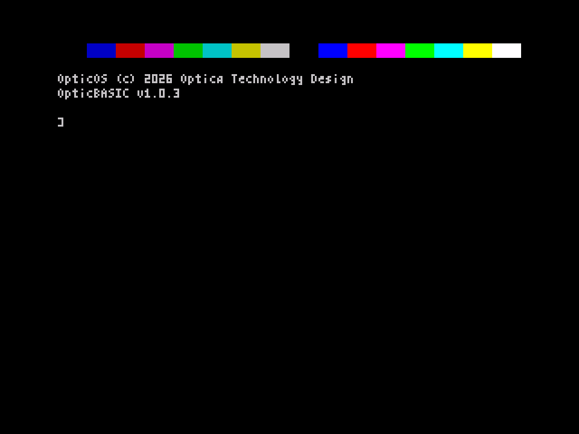
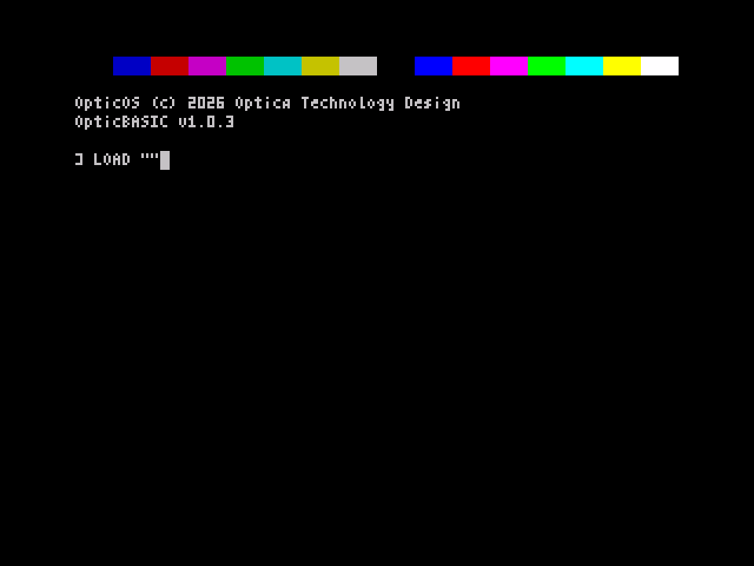
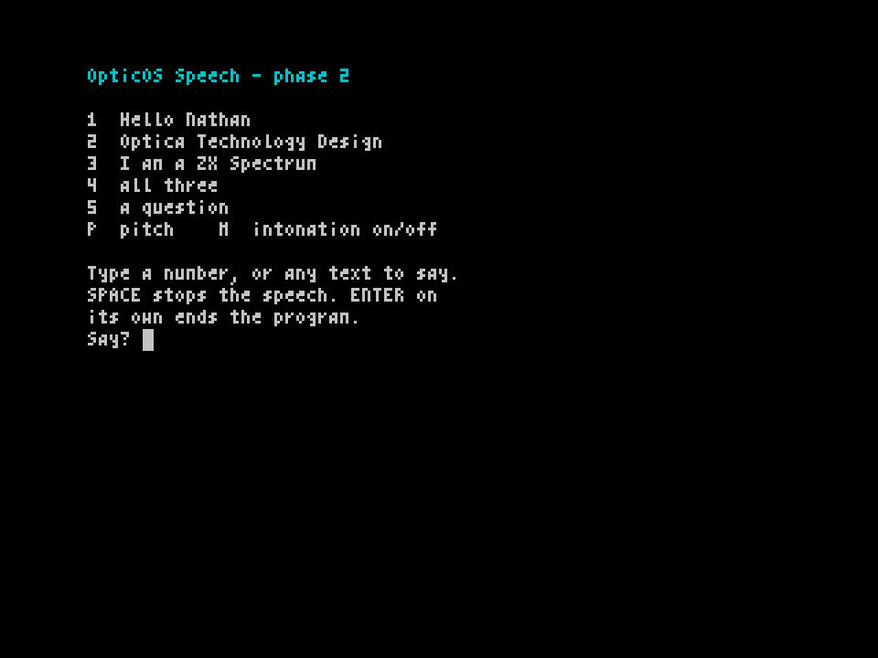
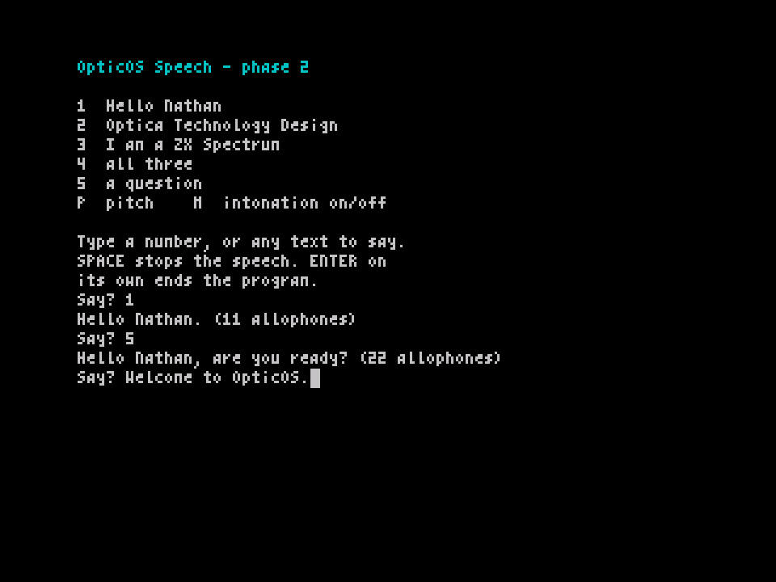
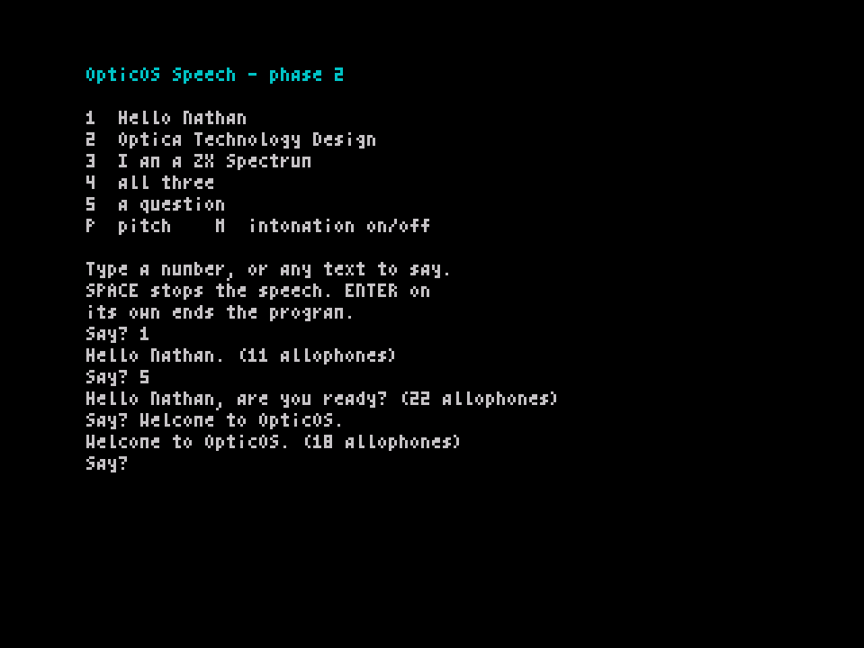
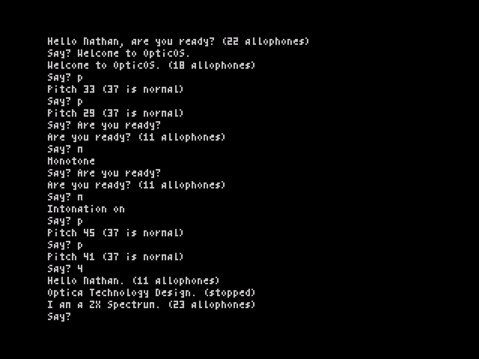
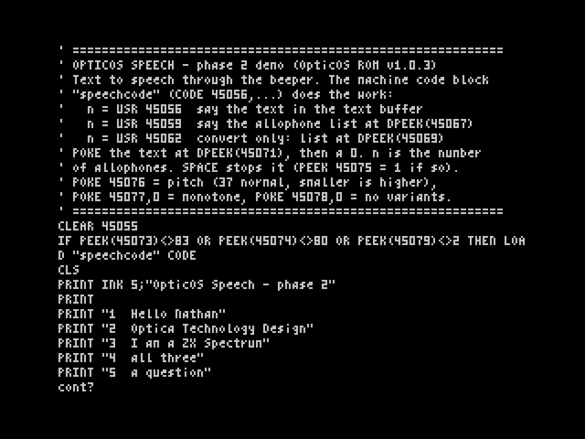

# ZX-Synth-Speak: OpticOS Speech (phase 2)

A software text-to-speech synthesiser for the 48K Spectrum running
**OpticOS**, driven from OpticBASIC. Text is converted to SP0256-style
allophones by the NRL/Elovitz letter-to-sound rules (in Z80 machine code), refined
with context variants and a simple intonation pass, and played from
pre-synthesised 1-bit allophones held in RAM through the beeper (port 254, bit 4).
No extra hardware is needed.

**Listen:** [`audio/presets_all.mp3`](audio/presets_all.mp3) (the three presets),
[`audio/question.mp3`](audio/question.mp3) ("Hello Nathan, are you ready?"),
[`audio/compare_phase1_phase2.mp3`](audio/compare_phase1_phase2.mp3) (each phrase as phase 1, then phase 2).

## In Fuse with the OpticOS ROM

Screens from Fuse 1.6.0 (SDL) running `build/opticos.rom`, captured by
`tools/fuse_test.py` (3x, 960 x 720).

| | |
|---|---|
|  |  |
| OpticOS starts | `LOAD ""` loads `speech` (auto-runs) and `speechcode` |
|  |  |
| The demo menu | Presets 1 and 5 spoken; typing your own text |
|  |  |
| Spoken, and back to the `Say?` prompt | Pitch (P), monotone (M), and SPACE stopping a phrase |
|  | |
| `LIST`: the OpticBASIC demo (no line numbers) | |

## Quick start

    LOAD ""            (speech.tzx: BASIC "speech" auto-runs, then CODE "speechcode")

The demo offers 1–3 the presets ("Hello Nathan", "Optica Technology Design", "I am
a ZX Spectrum"), 4 all three, 5 a question, P to step the pitch, M to switch
intonation on or off, or speaks any text you type. SPACE stops the speech; ENTER on
its own ends the program.

## Calling it from OpticBASIC

    CLEAR 45055
    LOAD "speechcode" CODE
    DEF PROC say(s$)
      LOCAL a, i, n
      a = DPEEK(45071)
      FOR i = 1 TO LEN s$: POKE a + i - 1, ASC MID$(s$, i, 1): NEXT i
      POKE a + LEN s$, 0
      n = USR 45056
    ENDPROC

| Address | What |
|---|---|
| `n = USR 45056` | convert the text at TEXTPTR (0 or 13 ends it, up to 250 characters) and say it; n = number of allophones |
| `n = USR 45059` | say the allophone list at LISTPTR (`$FF` ends it) |
| `n = USR 45062` | convert only; the list goes to `DPEEK(45069)` |
| 45065 / 45067 | TEXTPTR / LISTPTR (DPOKE to use your own buffers) |
| 45069 / 45071 | address of the allophone buffer / text buffer (read only) |
| 45073 | "SP" signature |
| 45075 | STOPPED: 1 if SPACE stopped the last phrase |
| 45076 | PITCH: voiced period in bytes, 37 = 105.6 Hz (normal); smaller is higher; 24–56 is sensible |
| 45077 | INTON: 1 = intonation (default), 0 = monotone |
| 45078 | VARIANTS: 1 = context variants (default), 0 = the rules' allophones as they are |
| 45079 | version (2) |

* Any case. Spaces give a short pause, `,` `;` `:` `-` a medium pause, `.` `!` `?` a
  long pause; digits are spoken ("1" → "one").
* Allophone codes are SP0256 numbers 0–63; **bits 6–7 are the pitch level** (0 mid,
  1 low, 2 high, 3 top). `USR 45062` returns codes with these bits set.
* SPACE (so also BREAK) is checked before each allophone. Interrupts are off while
  a phrase plays; the border colour is kept.

### Interface changes from phase 1

* The three entry points, TEXTPTR/LISTPTR and the info words at 45069/45071 are unchanged.
* The buffers moved (text buffer now 62242, allophone buffer 62762): read them with
  `DPEEK(45071)` / `DPEEK(45069)` as before rather than hard-coding them.
* New variables at 45075–45079. Code bytes 64–254 in an allophone list now mean
  "code + pitch level" (phase 1 skipped them); lists of plain 0–63 codes play as before.
* CODE block: `CODE 45056,17186` (phase 1: 18690). CLEAR 45055 as before.

## Memory map

| Address | Hex | What |
|---|---|---|
| **CLEAR 45055** | | RAMTOP; everything above is the speech system |
| 45056–45079 | B000 | jump table and variables (above) |
| 45080–46710 | B018 | player, converter, post-pass (1,631 bytes) |
| 46711–47028 | B677 | rule index, letter classes, variant tables (318) |
| 47029–49306 | B7B5 | NRL rules, 362 incl. 33 exceptions (2,278) |
| 49307–49434 | C09B | allophone pointer table (128) |
| 49435–62241 | C11B | allophone waveform data (12,807) |
| 62242–62497 | F322 | text buffer (256) |
| 62498–62761 | F422 | word buffer (264) |
| 62762–63273 | F52A | allophone list buffer (512) |

Saved block `CODE 45056,17186`; 18,218 bytes in all with the buffers (phase 1:
19,722). 63274–65535 is untouched (UDGs etc.).

## Intelligibility: phase 1 vs phase 2

20 test phrases (108 words: the presets, digits, game phrases and Harvard sentences),
rendered from the 1-bit data **exactly as the Z80 plays it**, filtered like a
speaker (60 Hz – 5 kHz), and transcribed by two automatic recognisers.
Score = reference words recognised, in order (`tools/evaluate.py`, results in `eval/`).

| Words recognised | vosk small-en | Whisper base.en |
|---|---|---|
| Phase 1, 1-bit beeper output | 3/108 (2.8%) | 23/108 (21.3%) |
| **Phase 2, 1-bit beeper output** | **31/108 (28.7%)** | **62/108 (57.4%)** |
| Phase 1, float synthesis (before 1-bit) | 8/108 (7.4%) | 19/108 (17.6%) |
| Phase 2, float synthesis (before 1-bit) | 22/108 (20.4%) | 54/108 (50.0%) |

Whisper on the recordings: phase 1 "Hello no fun", phase 2 "Hello Nathan"; Fuse's
own sound output (`audio/fuse_question.wav`): "Hello Nathan, are you ready?" word for
word. Phrases that come through: "Hello Nathan", "This is a test", "Please press any
key", "Game over", "We like to play games on the computer", "It is easy to tell...".
Hard ones: "Optica", "ZX", "good morning", R/L-heavy and unusual words. Run-to-run
spread of these scores is about ±3 points; a recogniser is a proxy, not a listening test.

What made the difference, measured one change at a time on the same test:

1. **Pre-emphasis before the 1-bit coder** (biggest single gain: Whisper 25% → 46%).
   1-bit noise is flat across the band while a vowel's spectrum falls steeply, so F2/F3
   (which carry vowel identity) were buried. Lifting the highs first (y = x − 0.95·x₋₁,
   then a tanh soft clip) keeps them above the noise: the classic result that
   differentiated, clipped speech stays intelligible.
2. **Optimised 1-bit periods** instead of plain delta-sigma: each stored 296-bit pitch
   period is searched (single-bit flips and edge moves) to minimise the error after a
   speaker-band weighting. +1–2 dB in band, and Whisper 7% → 18% against plain DSM at
   the same settings. (A phase-free variant and multi-level PWM were considered; PWM is
   a special case of a 1-bit pattern at the same bit rate, so the optimised patterns
   dominate it, and the player's timing loop stays unchanged.)
3. **A new synthesiser**: five-formant cascade, glottal pulses aligned to period starts
   (so the player can change pitch), consonant transitions from place-of-articulation loci,
   proper relative levels, sibilants inside the speaker band.
4. **Blended joins**: vowel edges glide in from and out towards a neutral position over
   ~30 ms to meet the consonant transitions (vosk 13% → 29%).
5. **Context variants** (below) and a slightly faster rate (0.85).

## How it works

**Text → allophones (Z80, `convert`).** Upper-cased, normalised text runs through the
1976 NRL rules (context classes `# : ^ . + % & @`, greedy, as the original) plus an
exceptions dictionary (HELLO, NATHAN, OPTICA, ZX, SPECTRUM, DESIGN, TECHNOLOGY…).
Then a post-pass (`post`):

* **Context variants** (table-driven, 64 + 100 bytes): K → KK1 before front vowels,
  KK3 before back vowels and liquids, KK2 elsewhere; likewise GG1/GG3/GG2; TT2/DD2/BB2
  (released, with transitions) before vowels and liquids, TT1/DD1/BB1 elsewhere; HH1
  before front vowels, HH2 otherwise; NN1/NN2, DH1/DH2; RR2 after a consonant; EL for a
  syllabic L. The variants are synthesised with matching formant transitions, so they
  are real acoustic cues, not just names.
* **Intonation**: the last word before `.`, `!` or the end gets pitch level 1 (a fall),
  before `?` level 2 (a rise). Levels change the voiced period: the player plays 33,
  37 or 41 bytes of each voiced period (118, 106, 95 Hz), padding with a 15.6 kHz
  pattern when lengthening; the glottal pulse sits at the start of each period, so
  cutting the tail is clean.

The Z80 converter is checked bit-for-bit against the Python reference
(`tools/test_convert.py`: 2,377 conversions, including all INTON/VARIANTS settings, 0 differences).

**Allophones (offline, `tools/synth.py`).** Source–filter formant synthesis at 31,250 Hz
(112 T-states per bit), pre-emphasis and soft clip, optimised 1-bit coding per pitch
period. Steady vowels store one period per 3, glides one per 2, noise one per 1–2;
silence costs nothing. Deterministic (noise is seeded per allophone).

Only the SP0256-AL2 allophone *names and numbering* are used, as a public reference.
No SP0256 data or recordings are used.

**Player (Z80, `play`).** For each allophone: check SPACE, pick the period length from
PITCH and the code's level, then walk the frames: header `0` = end, `$80+n` = n silent
periods, otherwise bits 0–5 = repeats and bit 6 = voiced, followed by 37 bytes. Each bit
is an exactly padded 112 T sequence (`rl e / sbc a,a / and 16 / or border / out ($FE),a`),
generated by `tools/gen.py`; data and code are above 32768, so there is no contention.
If SPACE stops it, it waits for the key to be let go and clears FLAGS bit 5, so BASIC
does not see the key.

## Building and testing

Needs Python 3 with numpy and scipy, pasmo, and an OpticOS checkout (for
`build/opticos.rom`, the `tools/rig` Z80 harness and the Fuse helpers): set `OPTICOS=`
to its path (default `/workspace/opticos-repo`). No Sinclair ROM is used anywhere.
For the scores: `pip install vosk openai-whisper` and the vosk-model-small-en-us-0.15
model in `ref/vosk/`.

    python3 tools/gen.py           # synthesise + code the allophones, pack rules, assemble build/speech.bin
    python3 build.py               # type speech.bas into the rig, SAVE speech.tap / speech.tzx with the OpticOS ROM
    python3 tools/test_convert.py WORDS…   # Z80 converter == Python reference
    python3 tools/test_play.py "text" …    # USR 45056 in the rig; speaker edges vs the reference; SPACE stop; audio/*.wav
    python3 tools/fuse_test.py     # real Fuse: LOAD "", presets, P/M, SPACE, LIST; shots/*.png, audio/fuse_*.wav
    python3 tools/evaluate.py --asr vosk,whisper [--tools DIR] [--mode bits|float]

Results: converter 0 differences; player edges match the reference for every test
phrase (99.4% of edges within 0.6 bit, worst 10.6 bits at allophone boundaries; total
time +0.6% from the player's housekeeping); SPACE stops and returns cleanly; in Fuse
the tape loads and everything in the screens above works.

## Audio (`audio/`)

* `presets_all.mp3`, `question.mp3`, `hello_nathan.mp3` / `.m4a`
* `compare_phase1_phase2.mp3`: four phrases, each phase 1 then phase 2
* rig recordings (the Z80 player's output in the test rig): `hello_nathan.wav`,
  `optica_technology_design.wav`, `i_am_a_zx_spectrum.wav`, `welcome_to_opticos.wav`,
  `one_two_three_four_five.wav`, `hello_nathan_are_you_ready.wav`
* Fuse's own sound output: `fuse_hello_nathan.wav`, `fuse_question.wav`,
  `fuse_high_pitch.wav` (PITCH 29), `fuse_monotone.wav`
* `phase1/`: the phase 1 recordings, for comparison

## Limitations

* Still a robotic, buzzy 1-bit voice: about half the words of unfamiliar sentences are
  recognised by Whisper, under a third by vosk. Short, common phrases fare best.
  No formal human listening test yet.
* Allophones are context-free apart from the variants: no true diphones, so some joins
  are still abrupt.
* Intonation is per word and three levels only; no lexical stress, so long words are flat.
* NRL rules mispronounce many irregular words; add exceptions in `tools/front.py`.
* Interrupts are off while a phrase plays (FRAMES does not advance); SPACE is checked
  between allophones, so stopping takes up to ~0.25 s.
* Pitch changes slightly alter the duration of voiced sounds.

## Possible next steps

Stress from the rules (pitch and length on stressed vowels), diphone-style transition
frames for the commonest pairs, a listening test, SAY as an OpticBASIC library PROC,
and AY-3-8912 output on the 128K.

## Licences and sources

See `LICENSE`: code MIT, documentation and audio CC BY 4.0.

* NRL rules: Elovitz, Johnson, McHugh & Shore, *Automatic Translation of English Text
  to Phonetics by Means of Letter-to-Sound Rules*, NRL Report 7948 (1976), public
  domain; JSON form from greg-kennedy/p5-NRL-TextToPhoneme (Unlicense), in `data/nrl/`.
* Formant targets after Peterson & Barney (1952) and Klatt (1980) published tables.
  Harvard sentences (IEEE 1969) in the test set.
* Synthesiser, coder, player, converter and data: original work for OpticOS.
