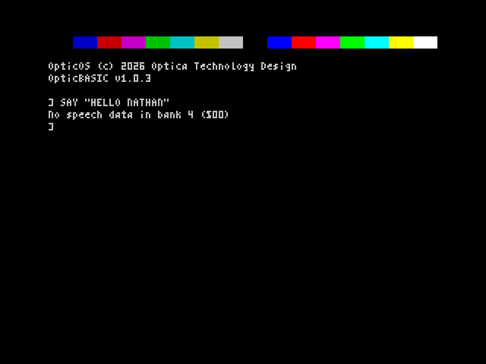
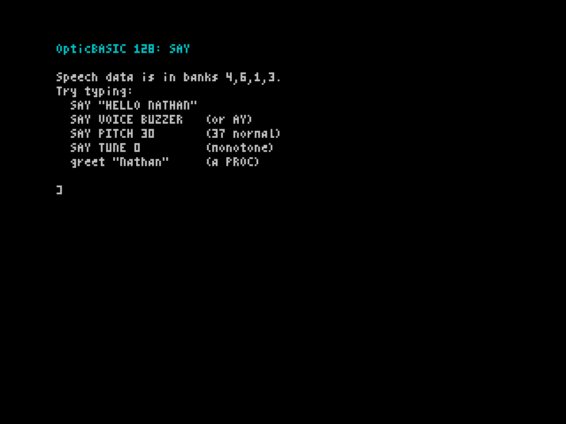
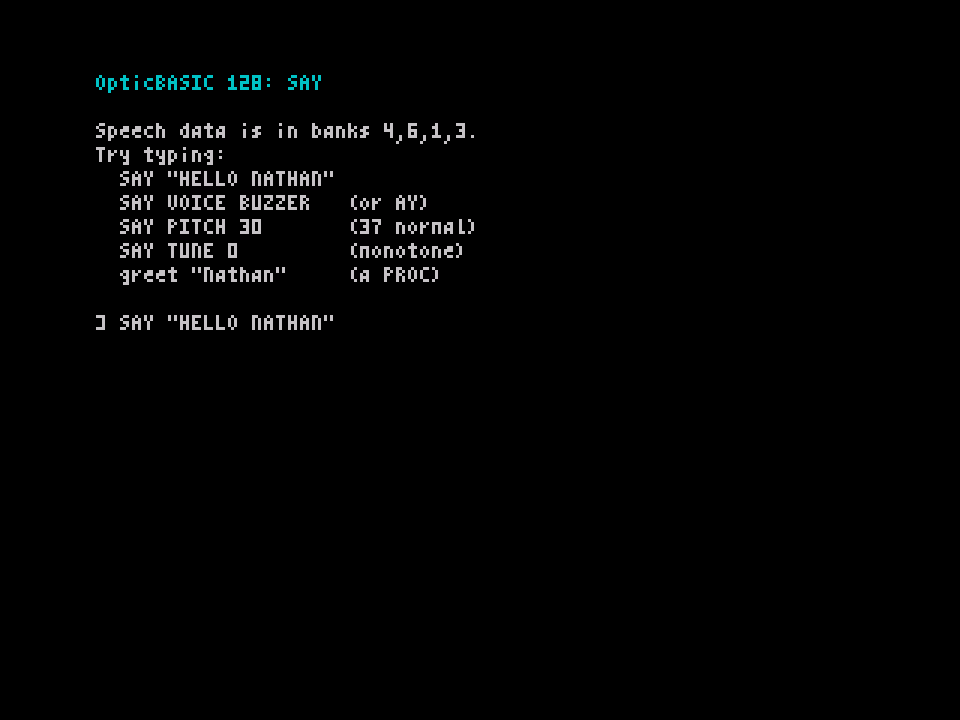
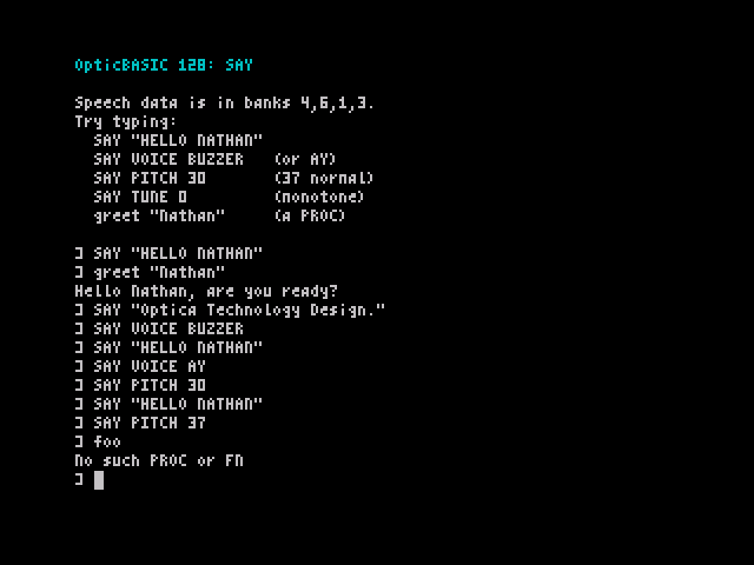
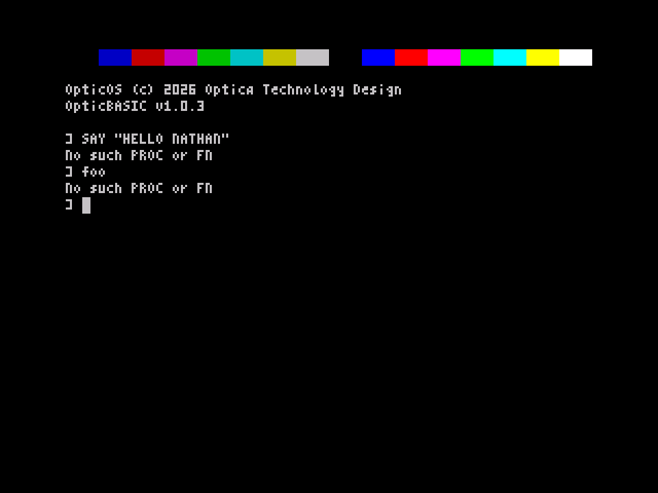
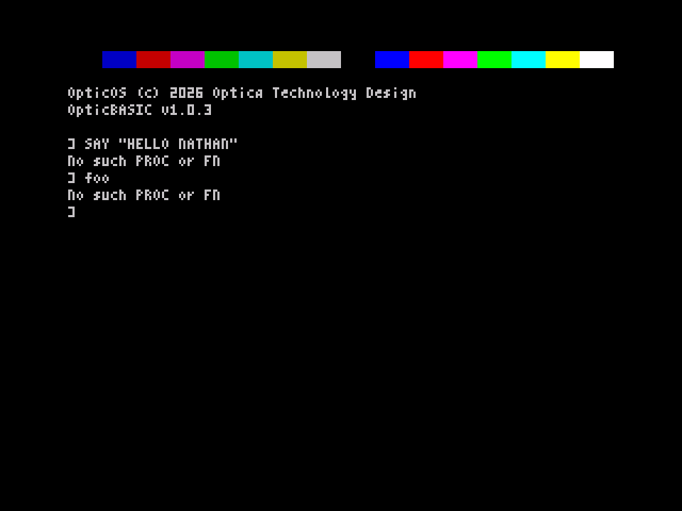

# OpticBASIC 128: SAY (design and phase 1 prototype)

`SAY "HELLO NATHAN"` typed at the OpticBASIC prompt on a 128K Spectrum, spoken by
ZX-Synth-Speak (phase 3 voice) through the AY chip or the beeper. Only OpticOS ROMs
are used: OpticOS in ROM slot 0, and a new clean-room **extension ROM** in slot 1.
No Sinclair ROM (48K or 128K) is used, read or needed.

| | |
|---|---|
|  |  |
| The extension answers at once and raises its own error | `say128.tzx`: `SAY LOAD` has put the sound data in banks 4, 6, 1, 3 |
|  |  |
| A typed line | SAY, SAY a$ in a PROC, VOICE, PITCH; `foo` still gives "No such PROC or FN" |
|  |  |
| 48K, same OpticOS ROM: unchanged | 128K, OpticOS in both slots: unchanged |

## Architecture: "OpticOS 128"

```
 ROM slot 0  OpticOS (16K, 48K-style; branch opticos128-say adds a 14-byte hook)
 ROM slot 1  OpticBASIC 128 extension ROM: SAY parser, text-to-speech converter,
             rules, beeper and AY players, directories, AY table (all in ROM)
 RAM bank 4  beeper allophones (SPKD header) + SAY settings at $FFF0
 RAM banks 6, 1, 3   AY allophones (SPKD headers)
 RAM $BA00-$BFFF     SAY's workspace, borrowed from free memory during each SAY
```

**Why this design.** OpticOS has about 116 bytes free, far too few for SAY itself (the
speech code and rules are about 6.7K), but enough for a hook. The 128K already has a
second ROM slot, selected by port $7FFD bit 4, so the whole extension lives in ROM:
no `CLEAR 38911`, no resident code in BASIC's memory, and the 48K is untouched.
Alternatives considered:

| Option | For | Against |
|---|---|---|
| **Extension ROM in slot 1 + hook (chosen)** | Nothing resident in RAM, no CLEAR; ROM code is uncontended (exact timing); room for more statements (5.4K spare) | Needs a ROM image in slot 1 (an emulator setting, or a ROM swap / custom-ROM option on hardware) |
| RAM-resident extension through a RAM vector in the hook | Works on a 48K too, no second ROM | Needs a fixed RAM byte or two for the vector (all of $5B00-$5DEF is in use) and ~10K resident with CLEAR, as now |
| Freeing ROM bytes by rework | Could put a small SAY in OpticOS itself | Still nowhere near 7K; risky changes all over a finished ROM |
| PROC library in BASIC (`say "text"` calling `USR`) | Works today (speech128.tzx) | Not a keyword; CLEAR and the 10K resident block |

## The hook (OpticOS branch `opticos128-say`, 14 bytes)

A statement that starts with an identifier which is not an assignment is a bare PROC
call (`si_pc` in `basic.asm`). When no PROC of that name exists, OpticOS now jumps to
`ext_hook` (`src/ext128.asm`, placed in the 24-byte gap at the end of section H):

```
ext_hook ($0D97):  ld bc,$7FFD
                   ld a,$10        ; ROM slot 1, RAM bank 0 at $C000, screen 5
                   scf             ; carry = not handled
                   out (c),a       ; the next fetch comes from whichever ROM is paged now
ext_back ($0D9F):  ret nc          ; handled: back to the run loop
                   rst 8 / ERR_NOPRC   ; "No such PROC or FN", as before
```

* **48K:** $7FFD is an odd port, ignored by the ULA; the same code runs on: the error.
* **128K with OpticOS in both slots:** slot 1 has the same bytes; the same result.
* **128K with the extension ROM:** the extension has `JP ext_main` at $0D9F. It returns
  with `OUT (C),A` (A = 0, BC = $7FFD) placed at $0D9D in its own ROM, so the next
  fetch is OpticOS's `ext_back`: NC = statement done, C = not its name (the error).

Cost: 3 bytes (`jp ext_hook` in `si_pc`) + 11 bytes (`ext_hook`) = **14 bytes**; the ROM
layout check passes with **113 bytes still free**. Interface for extension ROMs: the
address of `ext_back` (from `opticos.sym`), `CH_ADD` at the name token
(`$01 type hash length name`, lower case), and the run loop's return address on the stack.

## The extension ROM (`src/ext128_main.asm` + the speech code; `tools/gen.py` builds `build/opticos128ext.rom`)

| Address | What |
|---|---|
| $0000 | RST 0 while paged: page ROM 0 and boot OpticOS (via `OUT (C),A` at $0072 = OpticOS `boot`-2) |
| $0038 | IM 1 while paged: `push af / pop af / ei / ret` (the extension runs only briefly with interrupts on) |
| $0D9D | `OUT (C),A`: the way back to ROM 0 |
| $0D9F | `JP ext_main` (OpticOS's `ext_back`) |
| $0DA2-$2864 | SAY parser, ROM 0 far-call, SAY LOAD, settings; then the phase 3 converter, rules, beeper and AY players, directories (64 × bank, address each) |
| $2865-$3CFF | free (5.3K): diphones, more statements |
| $3D00-$3FFF | AY volume table (3 × 256) |

**Calling OpticOS from the extension.** OpticOS uses IY, so a far call carries its target
inline: `call far / dw OS_ev_expr`. `far` patches a small RAM trampoline (copied to
$BA10 on each SAY) that pages ROM 0 (keeping the current RAM bank), calls the routine,
and pages ROM 1 back, keeping AF, BC, DE and HL across the paging. It uses OpticOS's own
`id_skip`, `ev_expr`, `ev_pop`, `ev_int`, `LD_BYTES` and its error entries, so syntax,
type and range errors are OpticOS's own (they unwind through ERR_SP with ROM 0 paged).
The extension's own error ("No speech data in bank N") uses OpticOS's `EMSGN`/`EMBUF`
custom-message mechanism (the one `ERROR n, msg$` uses), error code 22.

**RAM.** OpticOS keeps its machine stack, value stacks, direct line and string heap
at the top of RAM, in bank 0 at $C000+, so they disappear whenever a sound bank is
paged in. (That is also why `OUT 32765,n` from BASIC crashes OpticOS 128, and why
the 48K-style speech128.tzx needs CLEAR 38911.) So each SAY borrows $BA00-$BFFF from
free memory, checking that it is free (VEND ≤ $BA00 and the heap bottom HP ≥ $C000;
otherwise "No room"), and runs the whole statement on a private stack there
($BF08-$BFFF): the text buffer, the allophone list, the converter's variables and the
trampoline. Nothing is resident between SAYs. Settings persist in bank 4 at $FFF0
("SK", pitch, intonation, variants, voice).

## Syntax

Implemented in the prototype:

| Statement | What |
|---|---|
| `SAY "text"`, `SAY a$`, `SAY expr$` | speak a string (up to 250 characters); SPACE stops it |
| `SAY PITCH n` | voiced period, 24-56 (37 normal, smaller is higher) |
| `SAY VOICE AY` / `SAY VOICE BUZZER` / `SAY VOICE n` | AY chip (1, default) or beeper (0). (`BEEPER` would tokenise as the `BEEP` keyword.) |
| `SAY TUNE 0` / `SAY TUNE 1` | monotone / intonation |
| `SAY LOAD` | load the next four CODE blocks named `bankN` from tape into RAM bank N |

Proposed for phase 2: `SAY ON` / `SAY OFF` (mute; also lets games keep SAY lines),
`SAY STOP` (from an `ON BREAK`-style handler), `SAY SPEED n`, `SAY PHONEMES a$`
(SP0256 codes, for exact control), `SAY BANKS b4,b6,b1,b3` (move the data), a `SAYING`
function (1 while speaking, with interrupt-driven AY playback), and `SAY SAVE` to write
the four banks back to tape.

## What works in Fuse (128K, OpticOS ROMs only)

`fuse --machine 128 --rom-128-0 opticos.rom --rom-128-1 opticos128ext.rom`, tape
`say128.tzx` (`tools/fuse_say_test.py`):

* Typed `SAY "HELLO NATHAN"` before loading: "No speech data in bank 4": the hook and
  extension run, and the error is clean.
* `LOAD ""`: the program runs `SAY LOAD` (four banks, through OpticOS's own LD-BYTES) and
  `SAY "Speech is ready."`.
* Typed lines: `SAY "HELLO NATHAN"`, `greet "Nathan"` (a PROC doing `SAY a$`),
  `SAY "Optica Technology Design."`, `SAY VOICE BUZZER`, `SAY VOICE AY`, `SAY PITCH 30`,
  `SAY PITCH 37`; then `foo` still gives "No such PROC or FN".
* Whisper on Fuse's recorded sound (`eval/say128_fuse.json`): AY "Hello Nathan" →
  "Hello Nathan"; beeper "Hello Nathan" → "Hello Nathan" (vosk too); AY "Hello Nathan,
  are you ready?" → "Hello, Mason, I'm ready"; PITCH 30 and "Optica Technology Design"
  not recognised.
* Unchanged: a 48K with the branch OpticOS ROM, and a 128K with OpticOS in both slots,
  give "No such PROC or FN" for `SAY "HELLO NATHAN"` and `foo`. OpticOS's rig test
  suites pass as on main (phase 3 49/49, phase 4 13/13, phase 5 91/91, maths and NEW
  0 failures; the traps and phase 1 tests fail only where a Mire Mare tape is missing
  in this environment, identically on main).
* `tools/similarity_check.py` against 48.rom: OK for the branch OpticOS ROM and for the
  extension ROM (no shared run of 12+ bytes outside the font and filler).

## Limitations (phase 1)

* Needs an emulator (or hardware) that takes a ROM image for slot 1. With the extension
  in slot 1, a program must never `OUT 32765` with bit 4 set (that pages the extension
  under BASIC); and plain `OUT 32765,bank` crashes because OpticOS's stack is at $C000+.
  Use `SAY LOAD`.
* Tape loading through ROM 0 is not trapped by Fuse (its 128K traps act on slot 1), so
  `say128.tzx` loads at normal speed (`--fastload` helps).
* While speaking, interrupts are off (FRAMES stops); SAY returns when done.
* The workspace check means a program whose variables reach $BA00, or whose string
  heap dips below $C000 (a large heap, or a CLEAR below 49152), gets "No room".
* Settings live in bank 4, so they need the data loaded; `SAY PITCH` before `SAY LOAD`
  gives the data error.
* The banks are fixed at 4, 6, 1, 3 in this build (the directories are in ROM).
* +2A/+3: the hook works (bit 4 is the low ROM bit with $1FFD = 0), but banks 4-7 are
  the contended ones there, so the timing is a few percent off; untested.

## Phase 2 proposal

1. Statements: `SAY ON/OFF`, `SAY STOP`, `SAY SPEED`, `SAY PHONEMES`, `SAY BANKS`,
   `SAY SAVE`; `SAYING` as a function needs a second hook (unknown FN names: the same
   trick at `err_noprc`'s FN caller in `error2.asm`, about 10 more bytes).
2. Background speech: an IM 2 player on the AY (a vector table in RAM) so programs run
   while it talks; the AY sample stream at a lower rate with one sample per interrupt
   batch, or fixed-length frames per interrupt.
3. Use the spare 5.3K of the extension ROM and banks 0/7 for diphones and stress
   lengthening (phase 3's main limitations).
4. A general extension mechanism: a name table in the extension ROM so other keywords
   (sound, banked arrays, a RAM disc) share the same 14-byte hook.
5. **The Spectrum (Retro Games, 2024):** it accepts custom 128K ROMs from USB as
   `/THESPECTRUM/roms/128-0.rom` and `128-1.rom` with the 128K/Universal machine
   setting (per Retro Games' support page), so `opticos.rom` (branch build) as
   `128-0.rom` and `opticos128ext.rom` as `128-1.rom` should run this prototype. Not yet
   tried: things to check are its 7FFD paging and AY output (it emulates a 128K, so
   both should be there), and loading: its instant `.tap` loading is likely tied to
   the ROM's loader in slot 1, so `say128.tzx` may need its real-time (or
   accelerated) tape mode, or SAY LOAD could gain a fast path.
